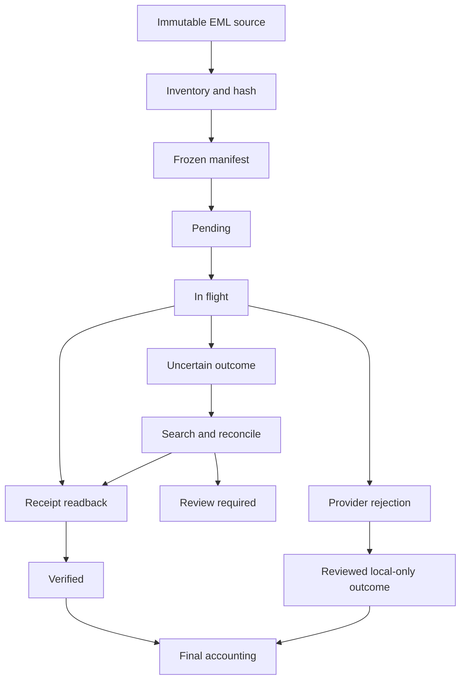

# ITCCK migration — software engineering case study

The work involved moving exported Cafe24 mail into Google Workspace. This case study focuses on the Python software built around that task, rather than service offerings or sales claims.

## The engineering problem

An EML importer has to do more than upload bytes. It must preserve its source, retain message identity and dates, survive interruption, distinguish an API rejection from a lost response, and provide an auditable outcome for every source row.

The tooling evolved from a five-message pilot to bounded batch processing and then a configurable resumable engine.

## Explicit state and recovery

A transport timeout does not prove that Gmail rejected the upload. Recording an uncertain state and reconciling it before retrying prevents a network problem from becoming a duplicate-message problem.

## Data integrity

The preparation phase freezes source paths and hashes. Repairs produce separate upload representations, preserving the originals. Specialized variants constrain repairs to exact fingerprints and byte ranges, and compare decoded attachment content or authored headers where appropriate.

The public historical examples replace those original fingerprints and mailbox identifiers. They illustrate the technique; they cannot reconstruct the client archive.

## Authorization and operational controls

The v2 engine separates preparation, interactive authorization and execution. Credentials are bound to the destination and OAuth client. A normal resume refreshes a saved grant instead of opening another consent flow.

Checkpoints use locks and atomic replacement. The code treats account mismatch, source drift, ambiguous candidates and unreviewed failures as blocking conditions.

## Testing

The portable suite covers parsing and normalization, source mutation, duplicate and collision policies, credential handling, checkpoint integrity, retry decisions, uncertain uploads and readback.

The pilot tests use five generated EML messages to verify that changed source bytes, wrong OAuth clients and an unconfirmed destination prevent execution.

Historical tests that depended on the actual client archive remain labelled reference material. They are not included in the portable test count.

## What the evidence establishes

The client engagement covered four accounts, with separate frozen import scopes. This repository demonstrates the implementation and its offline regression checks. It does not claim every original folder or rejected message was imported, live synchronization, universal byte-for-byte Gmail storage, or AI-transformation results.

[Source map and variants](VARIANTS.md) · [Usage](USAGE.md)
